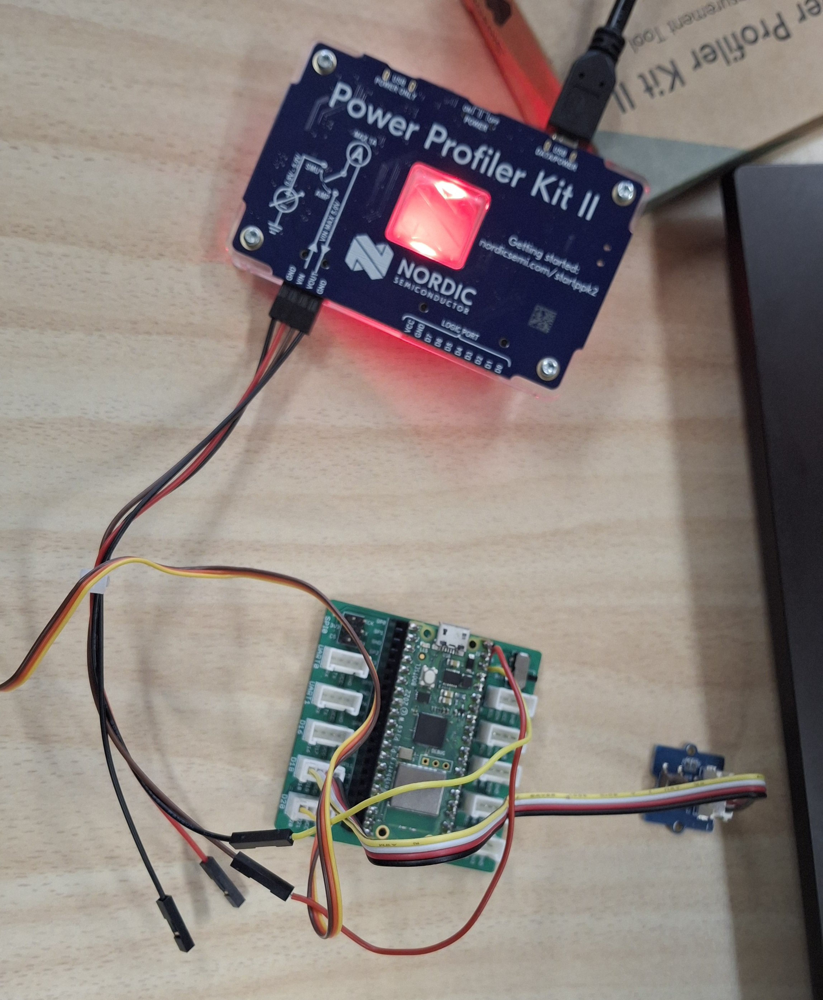
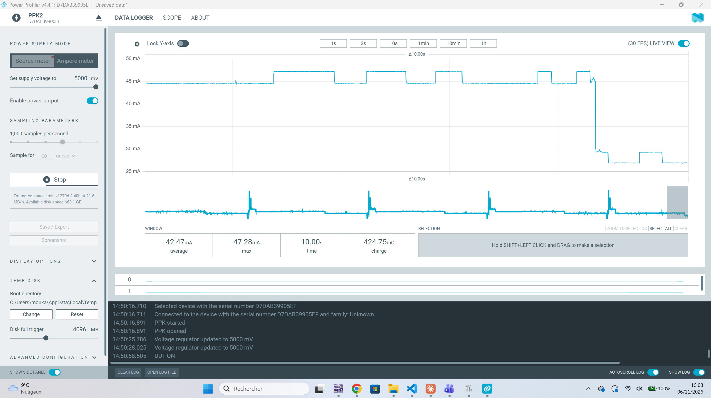

# Horloge connectée et profilage énergétique

Ce programme transforme un servomoteur en aiguille d'horloge. L'heure est récupérée sur Internet
par Wi-Fi. La consommation du Pico W est ensuite mesurée avec un Power Profiler Kit 2 (PPK2).

[⬅ Retour au README principal](../README.md)

---

## Matériel

- Raspberry Pi Pico W
- Grove Shield for Pi Pico
- Servomoteur 180°
- Bouton-poussoir Grove (bonus)
- Power Profiler Kit 2 (PPK2)
- Câbles

---

## Câblage



| Module | Connecteur |
|---|---|
| Servomoteur | D20 |
| Bouton-poussoir | D18 |

---

## Installation

1. Écrire le nom et le mot de passe du Wi-Fi dans `secrets.py`.
2. Copier `horloge.py` et `secrets.py` sur le Pico.

Le fichier `secrets.py` n'est pas publié sur GitHub (il est listé dans `.gitignore`).

---

## 1. Connexion à Internet

Le Pico se connecte au Wi-Fi avec le module `network`, puis récupère l'heure UTC avec
`ntptime.settime()`. Le décalage du fuseau horaire est ensuite ajouté. Le Wi-Fi est coupé après
chaque synchronisation pour économiser l'énergie.

---

## 2. Calcul de l'angle

12 heures couvrent 180°, donc une heure vaut 180 / 12 = **15°**.

| Heure | 12 | 1 | 2 | 3 | 4 | 5 | 6 | 7 | 8 | 9 | 10 | 11 |
|---|---|---|---|---|---|---|---|---|---|---|---|---|
| Angle | 0° | 15° | 30° | 45° | 60° | 75° | 90° | 105° | 120° | 135° | 150° | 165° |

Les minutes sont prises en compte :

```python
angle = ((heure % 12) + minute / 60) * 15
```

---

## 3. Contrôle du servo

Le servo reçoit une impulsion toutes les 20 ms (50 Hz). La durée de l'impulsion fixe l'angle :
1000 µs pour 0° et 2000 µs pour 180°. Après chaque déplacement, le signal est coupé pour que le
servo ne force pas et ne chauffe pas.

---

## 4. Analyse de l'alimentation

```
USB (5 V) → VBUS → diode Schottky → VSYS → régulateur SMPS → 3,3 V
```

| Signal | Broche | Rôle |
|---|---|---|
| VBUS | 40 | 5 V venant du câble USB |
| VSYS | 39 | entrée principale d'alimentation (1,8 V à 5,5 V) |
| 3V3(OUT) | 36 | sortie du régulateur 3,3 V |
| GND | 38 | masse |

**Choix de la broche : VSYS (broche 39).** C'est l'entrée prévue pour une alimentation externe.
Le courant passe par le régulateur comme en utilisation normale, donc la mesure correspond à la
vraie consommation de la carte. La diode empêche le courant de repartir vers l'USB. La broche
3V3(OUT) est une sortie : l'alimenter contournerait le régulateur.

**Tension choisie : 5,0 V**, comme l'USB, dans la plage acceptée par VSYS (1,8 V à 5,5 V).

**Branchement du PPK2 (mode Source Meter) :**

| PPK2 | Pico W |
|---|---|
| VOUT | VSYS (broche 39) |
| GND | GND (broche 38) |

Le câble USB du Pico est débranché pendant les mesures.

---

## 5. Profilage énergétique

Avec `MODE_PROFILAGE = True`, le programme enchaîne 4 états de 10 secondes. Il doit être
enregistré sur le Pico sous le nom `main.py` pour redémarrer après le deep sleep.

| État | Description | Courant moyen |
|---|---|---|
| 1 | Actif avec Wi-Fi | … mA |
| 2 | Actif sans Wi-Fi | … mA |
| 3 | Light sleep | … mA |
| 4 | Deep sleep | … mA |

### Capture du PPK2



### Commentaire

Le Wi-Fi est l'élément qui consomme le plus. Le garder allumé en permanence augmenterait fortement
la consommation. Il vaut mieux l'allumer seulement pour récupérer l'heure, puis le couper.

Dans MicroPython sur le RP2040, `deepsleep()` fonctionne comme un light sleep suivi d'un
redémarrage. Les consommations des états 3 et 4 sont donc proches.

---

## Bonus

- **Un clic** : changement de fuseau horaire (UTC, UTC+1, UTC+2, UTC-5, UTC+9).
- **Double clic** : passage en mode 24 h, où une heure vaut 180 / 24 = 7,5° (0 h = 0°, 12 h = 90°,
  24 h = 180°).

Le fuseau et le mode sont sauvegardés dans `reglages.txt`.

---

## Fichiers

| Fichier | Description |
|---|---|
| [`horloge.py`](horloge.py) | le programme |
| `secrets.py` | identifiants Wi-Fi (non publié) |
| [`.gitignore`](.gitignore) | empêche la publication de `secrets.py` |
| [`images/montage.jpg`](images/montage.jpg) | photo du montage |
| [`images/simulation.png`](images/simulation.png) | capture du PPK2 |
