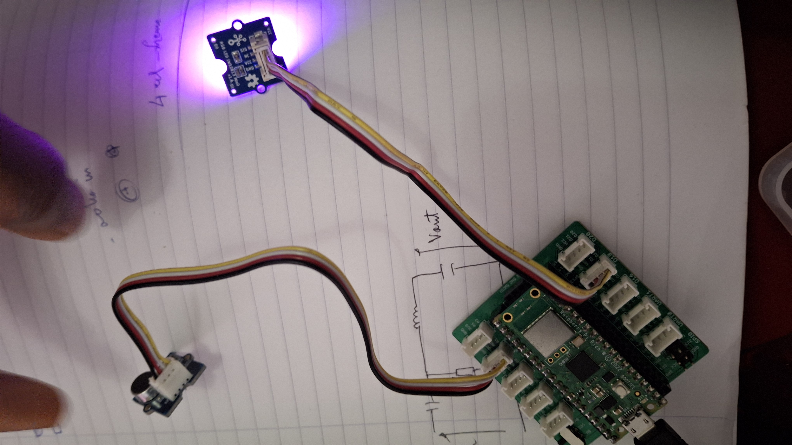

# LED RGB au rythme de la musique

Ce programme fait changer la couleur d'une LED RGB à chaque battement de la musique, détecté avec un
microphone. Il calcule aussi le rythme en BPM et enregistre la moyenne chaque minute dans un fichier.

[⬅ Retour au README principal](../README.md)

---

## Matériel

- Raspberry Pi Pico W
- Grove Shield for Pi Pico
- Module microphone Grove
- Module LED RGB
- Câbles Grove

---

## Câblage



| Module | Connecteur du shield |
|---|---|
| Microphone | A0, A1 ou A2 |
| LED RGB | D18 |

Dans le programme : `PIN_MICRO = 26` pour A0, `27` pour A1, `28` pour A2.

---

## Fonctionnement

### Mesurer le son

Toutes les 20 ms, le programme lit le micro et calcule l'écart entre la valeur la plus haute et la
plus basse. Plus le son est fort, plus cet écart est grand.

### Détecter un battement

Le programme garde une moyenne du niveau sonore. Un battement est détecté quand le son dépasse
1,5 fois cette moyenne, comme un coup de grosse caisse.

### Changer la couleur

À chaque battement, une couleur est tirée au hasard. La LED s'allume puis s'estompe jusqu'au
battement suivant.

### Calculer le BPM

Le BPM est calculé avec le temps entre deux battements :

```python
bpm = 60000 / intervalle_ms
```

Par exemple, 500 ms entre deux battements donnent 120 BPM.

### Enregistrer dans un fichier

Chaque minute, la moyenne des BPM est ajoutée dans le fichier `bpm.txt` du Pico :

```
Minute 1 : 118 BPM
Minute 2 : 122 BPM
```

Le fichier est ouvert avec `with`, ce qui le ferme automatiquement après l'écriture.

---

## Réglages

| Réglage | Rôle |
|---|---|
| `SENSIBILITE` | force du pic nécessaire pour détecter un battement |
| `NIVEAU_MIN` | niveau en dessous duquel le son est ignoré |
| `EXTINCTION` | vitesse à laquelle la couleur s'estompe (1.0 = reste allumée) |
| `LUMINOSITE` | luminosité de la LED |

---

## Fichiers

| Fichier | Description |
|---|---|
| [`rgb_musique.py`](rgb_musique.py) | le programme |
| [`images/montage.jpg`](images/montage.jpg) | photo du montage |
